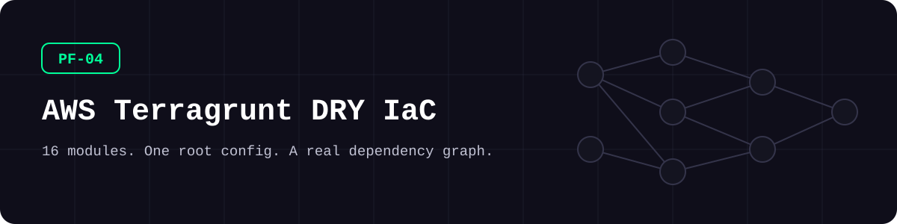
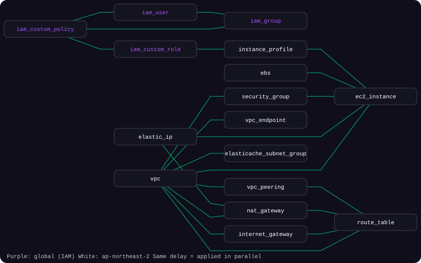
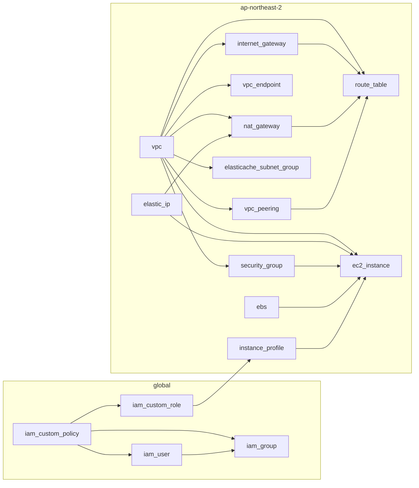

<picture>
  <source media="(prefers-color-scheme: dark)" srcset="docs/assets/banner-dark.svg">
  <source media="(prefers-color-scheme: light)" srcset="docs/assets/banner-light.svg">
  
</picture>

**Terraform 모듈 16개와 설정 파일 한 곳, 그리고 Terragrunt가 스스로 실행 순서를 정하는 의존성 그래프입니다.**

[](https://github.com/kimjhtlzk/pf-04-aws-terragrunt-dry-iac/actions/workflows/ci.yml)     [](https://github.com/kimjhtlzk/pf-04-aws-terragrunt-dry-iac/actions/workflows/ci.yml) [](LICENSE)

[English](README.md) | 한국어 · [포트폴리오](https://github.com/kimjhtlzk)

## 한눈에 보기

- **모듈 16개, 유닛 16개, 의존성 4단계**
- **설정 파일 1곳**이 backend·provider 블록 16벌을 대신합니다
- 전체 검증에 **클라우드 자격증명이 필요 없습니다** (`mock_outputs` 덕분입니다)
- 실제 운영 환경에 이 구조를 적용한 뒤 **배포 시간 40% 단축** (실무 적용 결과이며, 이 레포에서 측정한 값은 아닙니다)

## 구조

<picture>
  <source media="(prefers-color-scheme: dark)" srcset="docs/assets/dependency-graph-dark.svg">
  <source media="(prefers-color-scheme: light)" srcset="docs/assets/dependency-graph-light.svg">
  
</picture>



Terragrunt는 `dependency` 블록을 읽어 이 그래프를 만듭니다. 같은 단계의 유닛은 동시에 실행됩니다.

## 데모


## 구성 요소

| 모듈 | 설명 | 주요 리소스 |
|---|---|---|
| `vpc` | VPC, 서브넷, Flow Log, 닫힌 기본 보안 그룹 | `aws_vpc`, `aws_subnet`, `aws_flow_log` |
| `internet_gateway` | 인터넷 게이트웨이 | `aws_internet_gateway` |
| `nat_gateway` | 퍼블릭 NAT 게이트웨이 | `aws_nat_gateway` |
| `elastic_ip` | 고정 공인 IP | `aws_eip` |
| `route_table` | IGW·NAT·피어링 경로 | `aws_route_table` |
| `security_group` | 맵으로 쓰는 방화벽 규칙 | `aws_security_group` |
| `vpc_endpoint` | S3 게이트웨이 엔드포인트 | `aws_vpc_endpoint` |
| `vpc_peering` | 같은 계정 또는 다른 계정 간 연결 | `aws_vpc_peering_connection` |
| `ec2_instance` | 고정 IP와 추가 디스크를 갖춘 서버 | `aws_instance`, `aws_network_interface` |
| `ebs` | 암호화된 단독 디스크 | `aws_ebs_volume` |
| `instance_profile` | EC2 인스턴스 프로파일 | `aws_iam_instance_profile` |
| `elasticache_subnet_group` | ElastiCache 서브넷 그룹 | `aws_elasticache_subnet_group` |
| `iam_custom_policy` | 사용자 정의 정책 | `aws_iam_policy` |
| `iam_custom_role` | 역할과 정책 연결 | `aws_iam_role` |
| `iam_user` | 콘솔·키가 없는 사용자 | `aws_iam_user` |
| `iam_group` | 그룹과 구성원 | `aws_iam_group` |

## 폴더 구조

```text
.
├── modules/                     # 순수 Terraform 모듈 16개
│   └── vpc/                     # main, variables, outputs, versions, README
├── live/
│   ├── root.hcl                 # backend, provider, 공통 입력값
│   ├── _envcommon/              # 모듈별 source, 의존성, mock output
│   └── dev/
│       ├── account.hcl
│       ├── global/              # IAM 유닛
│       ├── ap-northeast-2/      # 리전 유닛
│       └── us-east-1/           # 두 번째 리전 자리
├── scripts/demo-run-all.sh      # 전체 유닛 검증, 유닛당 한 줄 출력
└── docs/                        # 구조, 설계 결정, 런북
```

## 빠른 시작

| 도구 | 버전 |
|---|---|
| Terraform | 1.9.8 |
| Terragrunt | 0.60.0 |

검증만 할 때는 AWS 계정이 필요 없습니다.

```bash
cd live/dev
export TF_PLUGIN_CACHE_DIR="$HOME/.terraform.d/plugin-cache" && mkdir -p "$TF_PLUGIN_CACHE_DIR"
export TF_PLUGIN_CACHE_MAY_BREAK_DEPENDENCY_LOCK_FILE=true
terragrunt run-all validate --terragrunt-non-interactive --terragrunt-parallelism 1
```

<details>
<summary>고급: 그래프 그리기, 실제 계정에 배포하기</summary>

```bash
terragrunt graph-dependencies | dot -Tsvg > graph.svg
```

배포하려면 `live/dev/account.hcl`에 계정을 넣고 AMI와 자리표시자 네트워크를 바꾼 뒤, `terragrunt run-all plan` 결과를 검토하고 `apply`하세요.

</details>

## 사용 예시

**유닛에는 입력값만 씁니다.**

```hcl
include "root" {
  path = find_in_parent_folders("root.hcl")
}

include "envcommon" {
  path           = "${dirname(find_in_parent_folders("root.hcl"))}/_envcommon/nat_gateway.hcl"
  merge_strategy = "deep"
}

inputs = {
  ngw = [{
    name       = "ngw-demo-vpc-1"
    eip        = dependency.elastic_ip.outputs.eip_id["demo-eip-2"]
    subnets    = dependency.vpc.outputs.subnets_ids["demo-vpc-1-subnet-1"]
    private_ip = "10.0.11.250"
  }]
}
```

**의존성은 `_envcommon`에 둡니다.**

```hcl
dependency "vpc" {
  config_path = "${get_terragrunt_dir()}/../vpc"

  mock_outputs = {
    subnets_ids = { "demo-vpc-1-subnet-1" = "subnet-00000000000000001" }
  }
  mock_outputs_allowed_terraform_commands = ["init", "validate", "plan"]
}
```

**리전을 추가합니다.**

```bash
cp live/dev/ap-northeast-2/region.hcl live/dev/us-east-1/region.hcl
sed -i '' 's/ap-northeast-2/us-east-1/' live/dev/us-east-1/region.hcl
cp -R live/dev/ap-northeast-2/vpc live/dev/us-east-1/vpc
```

## 설계 결정

- **Terraform 모듈은 순수하게 유지합니다.** 모듈은 Terragrunt를 모릅니다.
- **OpenTofu와 비교 후 Terragrunt를 골랐습니다.** 당시 성숙도, 생태계, DRY(중복 제거) 구조가 더 맞았습니다. 둘은 해결하는 문제가 달라 함께 쓸 수도 있습니다.
- **모듈은 한 벌만 둡니다.** 폴더로 버전을 나누던 방식을 바꿨고, 운영 환경에는 git 태그를 권장합니다.
- **안전한 기본값은 모듈에 넣습니다.** 호출하는 쪽에서 잊을 수 없습니다.

전체 기록: [docs/DECISIONS.md](docs/DECISIONS.md)

### 전환 전후 비교

| | 순수 Terraform | 이 레포 |
|---|---|---|
| backend 블록 | 루트마다 하나씩 16개 | `root.hcl`에 1개 |
| provider 블록 | 루트마다 하나씩 16개 | `root.hcl`에 1개 |
| 적용 순서 | 사람이 관리 | `dependency` 블록으로 자동 구성 |
| 리소스 생성 전 전체 검증 | 루트를 넘어서는 불가능 | mock으로 `run-all validate` |

## 보안 고려 사항

- IMDSv2(인스턴스 메타데이터 보안 버전) 강제, 디스크 암호화, VPC Flow Log 활성화, 기본 보안 그룹 차단
- 사람이 쓰는 역할은 MFA(다중 인증) 필수, IP 제한 정책으로 사무실 대역에서만 API 호출 허용
- 자리표시자만 사용합니다. [SECURITY.md](SECURITY.md)를 참고하세요
- CI가 push마다 checkov(보안 정적 분석)와 gitleaks(비밀값 탐지)를 실행합니다. `#checkov:skip`에는 모두 이유를 적었습니다

## 실무 맥락

4개 클라우드에서 운영하는 글로벌 게임 플랫폼의 여러 리전 인프라에 이 구조를 썼습니다. 리전이 늘며 생긴 코드 중복이 계기였고, 순수 Terraform에서 Terragrunt로 옮긴 뒤 배포 시간이 40% 줄었습니다.

## 이번 재구성에서 바뀐 점

| 유형 | 변경 |
|---|---|
| 구조 | 모듈 한 벌 유지, 표준 파일명, `_envcommon` 계층 추가 |
| 민감정보 | 실제 주소·계정·이름을 자리표시자로 교체 |
| 오류 수정 | 라우트 테이블 서브넷 연결 구현, 잘못된 output 이름 수정 |
| 테스트·CI | fmt, validate, tflint, checkov, terraform-docs, hclfmt, gitleaks |
| **데모용으로 새로 추가** | 안전한 기본값(Flow Log, IMDSv2, 암호화, 기본 SG 차단), MFA 조건, `demo-run-all.sh` |

자세한 내용: [docs/REFACTOR_NOTES.md](docs/REFACTOR_NOTES.md)

## 한계와 다음 계획

- 데모가 혼자 돌아가도록 state를 로컬에 둡니다. 팀에서는 `root.hcl`의 S3 예시로 바꿔야 합니다.
- `us-east-1`에는 리전 파일만 있습니다.
- CI는 검증까지만 하고 실제 적용은 하지 않습니다.

## 만든 사람

**김준현** · 퍼블릭 클라우드 인프라·보안 엔지니어

[포트폴리오](https://github.com/kimjhtlzk) · [LinkedIn](https://www.linkedin.com/in/ihanni/) · [블로그](https://hann-blume.tistory.com/)

## 시리즈의 다른 레포

| 번호 | 레포 | 보여 주는 것 |
|---|---|---|
| PF-01 | [pf-01-aws-terraform-multi-region](https://github.com/kimjhtlzk/pf-01-aws-terraform-multi-region) | `locals` 맵 하나로 만드는 16개 리전 AWS 플랫폼 |
| PF-02 | [pf-02-gcp-terraform-gke-platform](https://github.com/kimjhtlzk/pf-02-gcp-terraform-gke-platform) | SURGE 업그레이드와 기본 차단 방화벽을 갖춘 GKE 플랫폼 |
| PF-03 | [pf-03-tencent-terraform-audit-ready](https://github.com/kimjhtlzk/pf-03-tencent-terraform-audit-ready) | 감사 추적을 COS에 쌓는 Tencent Cloud IaC |
| PF-04 | [pf-04-aws-terragrunt-dry-iac](https://github.com/kimjhtlzk/pf-04-aws-terragrunt-dry-iac) | 실제 의존성 그래프를 가진 DRY Terragrunt 구조 |
| PF-05 | [pf-05-multicloud-asset-audit-automation](https://github.com/kimjhtlzk/pf-05-multicloud-asset-audit-automation) | 3개 클라우드 자산·감사 로그 수집 자동화 |
| PF-06 | [pf-06-aethercrew-ai-company](https://github.com/kimjhtlzk/pf-06-aethercrew-ai-company) | 안전장치를 갖춘 역할 기반 멀티 에이전트 회사 |
