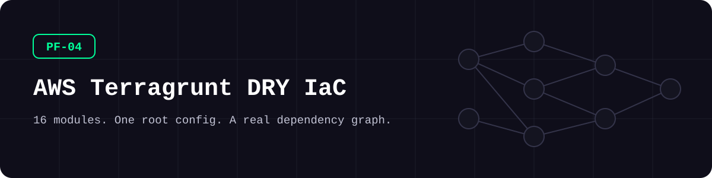
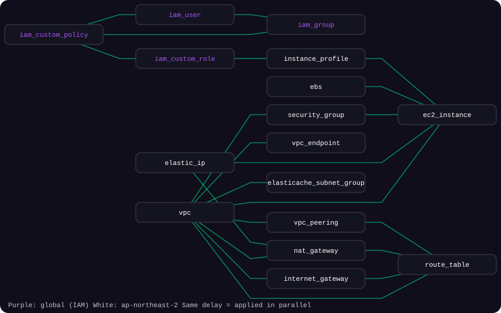

<picture>
  <source media="(prefers-color-scheme: dark)" srcset="docs/assets/banner-dark.svg">
  <source media="(prefers-color-scheme: light)" srcset="docs/assets/banner-light.svg">
  
</picture>

**Sixteen Terraform modules, one root config, and a dependency graph Terragrunt can run on its own.**

[](https://github.com/kimjhtlzk/pf-04-aws-terragrunt-dry-iac/actions/workflows/ci.yml)     [](https://github.com/kimjhtlzk/pf-04-aws-terragrunt-dry-iac/actions/workflows/ci.yml) [](LICENSE)

English | [한국어](README.ko.md) · [Portfolio](https://github.com/kimjhtlzk)

## At a glance

- **16 modules, 16 units, 4 dependency levels**
- **1 root config** replaces 16 copies of backend and provider blocks
- **0 cloud credentials** needed to validate the whole stack, thanks to `mock_outputs`
- **−40% deployment time** after moving a production estate to this pattern (production result, not measured in this repository)

## Architecture

<picture>
  <source media="(prefers-color-scheme: dark)" srcset="docs/assets/dependency-graph-dark.svg">
  <source media="(prefers-color-scheme: light)" srcset="docs/assets/dependency-graph-light.svg">
  
</picture>



```mermaid
flowchart LR
  subgraph global
    iam_custom_policy --> iam_user & iam_custom_role & iam_group
    iam_user --> iam_group
  end
  subgraph ap-northeast-2
    vpc --> internet_gateway & security_group & vpc_endpoint & vpc_peering & elasticache_subnet_group & nat_gateway
    elastic_ip --> nat_gateway
    vpc & internet_gateway & nat_gateway & vpc_peering --> route_table
    vpc & elastic_ip & security_group & ebs & instance_profile --> ec2_instance
  end
  iam_custom_role --> instance_profile
```

Terragrunt builds this graph from the `dependency` blocks. Units on the same level run in parallel.

## Demo


## What's inside

| Module | Description | Main resources |
|---|---|---|
| `vpc` | VPCs, subnets, flow logs, closed default SG | `aws_vpc`, `aws_subnet`, `aws_flow_log` |
| `internet_gateway` | Internet gateways | `aws_internet_gateway` |
| `nat_gateway` | Public NAT gateways | `aws_nat_gateway` |
| `elastic_ip` | Elastic IPs | `aws_eip` |
| `route_table` | IGW, NAT, and peering routes | `aws_route_table` |
| `security_group` | Rule maps with comma-separated CIDRs | `aws_security_group` |
| `vpc_endpoint` | S3 gateway endpoints | `aws_vpc_endpoint` |
| `vpc_peering` | Peering in or across accounts | `aws_vpc_peering_connection` |
| `ec2_instance` | Instances with fixed IP and extra disks | `aws_instance`, `aws_network_interface` |
| `ebs` | Standalone encrypted volumes | `aws_ebs_volume` |
| `instance_profile` | EC2 instance profiles | `aws_iam_instance_profile` |
| `elasticache_subnet_group` | ElastiCache subnet groups | `aws_elasticache_subnet_group` |
| `iam_custom_policy` | Customer-managed policies | `aws_iam_policy` |
| `iam_custom_role` | Roles and attachments | `aws_iam_role` |
| `iam_user` | Users with no console or key | `aws_iam_user` |
| `iam_group` | Groups and membership | `aws_iam_group` |

## Repository structure

```text
.
├── modules/                     # 16 plain Terraform modules
│   └── vpc/                     # main, variables, outputs, versions, README
├── live/
│   ├── root.hcl                 # backend, provider, common inputs
│   ├── _envcommon/              # source, dependencies, mock outputs per module
│   └── dev/
│       ├── account.hcl
│       ├── global/              # IAM units
│       ├── ap-northeast-2/      # regional units
│       └── us-east-1/           # second region, ready to fill
├── scripts/demo-run-all.sh      # validates all units, one line each
└── docs/                        # architecture, decisions, runbooks
```

## Quick start

| Tool | Version |
|---|---|
| Terraform | 1.9.8 |
| Terragrunt | 0.60.0 |

No AWS account is needed to validate.

```bash
cd live/dev
export TF_PLUGIN_CACHE_DIR="$HOME/.terraform.d/plugin-cache" && mkdir -p "$TF_PLUGIN_CACHE_DIR"
export TF_PLUGIN_CACHE_MAY_BREAK_DEPENDENCY_LOCK_FILE=true
terragrunt run-all validate --terragrunt-non-interactive --terragrunt-parallelism 1
```

<details>
<summary>Advanced: see the graph, or deploy to a real account</summary>

```bash
terragrunt graph-dependencies | dot -Tsvg > graph.svg
```

To deploy, set your account in `live/dev/account.hcl`, replace the AMI and the placeholder networks, then run `terragrunt run-all plan` and review it before `apply`.

</details>

## Usage examples

**A unit only states its inputs:**

```hcl
include "root" {
  path = find_in_parent_folders("root.hcl")
}

include "envcommon" {
  path           = "${dirname(find_in_parent_folders("root.hcl"))}/_envcommon/nat_gateway.hcl"
  merge_strategy = "deep"
}

inputs = {
  ngw = [{
    name       = "ngw-demo-vpc-1"
    eip        = dependency.elastic_ip.outputs.eip_id["demo-eip-2"]
    subnets    = dependency.vpc.outputs.subnets_ids["demo-vpc-1-subnet-1"]
    private_ip = "10.0.11.250"
  }]
}
```

**Dependencies live in `_envcommon`:**

```hcl
dependency "vpc" {
  config_path = "${get_terragrunt_dir()}/../vpc"

  mock_outputs = {
    subnets_ids = { "demo-vpc-1-subnet-1" = "subnet-00000000000000001" }
  }
  mock_outputs_allowed_terraform_commands = ["init", "validate", "plan"]
}
```

**Add a region:**

```bash
cp live/dev/ap-northeast-2/region.hcl live/dev/us-east-1/region.hcl
sed -i '' 's/ap-northeast-2/us-east-1/' live/dev/us-east-1/region.hcl
cp -R live/dev/ap-northeast-2/vpc live/dev/us-east-1/vpc
```

## Design decisions

- **Terraform stays plain.** Modules know nothing about Terragrunt.
- **Terragrunt over OpenTofu here.** Maturity, ecosystem, and DRY layout fit better at the time. They solve different problems and can be used together.
- **One copy per module.** Folder pinning was replaced, and git tags are the recommended path for production.
- **Secure defaults live in modules**, so callers cannot forget them.

Full records: [docs/DECISIONS.md](docs/DECISIONS.md)

### Before and after

| | Plain Terraform | This repository |
|---|---|---|
| Backend blocks | 16, one per root | 1, in `root.hcl` |
| Provider blocks | 16, one per root | 1, in `root.hcl` |
| Order of apply | Tracked by hand | Built from `dependency` blocks |
| Validate before anything exists | Not across roots | `run-all validate` with mocks |

## Security considerations

- IMDSv2 required, EBS and root volumes encrypted, VPC Flow Logs on, default security group closed
- Human roles require MFA, and an IP guard policy limits API access to the office range
- Placeholders only: see [SECURITY.md](SECURITY.md)
- CI runs checkov and gitleaks on every push. Each `#checkov:skip` states its reason

## Real-world context

This pattern ran a multi-region game platform operated across four cloud providers. Duplication across regions was the trigger. After moving from plain Terraform to Terragrunt, deployment time dropped by 40%.

## What changed in this refactor

| Type | Change |
|---|---|
| Structure | One copy per module, standard file names, `_envcommon` layer |
| Sensitive data | Real addresses, accounts, and names replaced with placeholders |
| Fixes | Route table subnet association now works, misnamed output corrected |
| Tests and CI | fmt, validate, tflint, checkov, terraform-docs, hclfmt, gitleaks |
| **New for the demo** | Secure defaults (flow logs, IMDSv2, encryption, closed default SG), MFA conditions, `demo-run-all.sh` |

Details: [docs/REFACTOR_NOTES.md](docs/REFACTOR_NOTES.md)

## Limitations and roadmap

- State is local so that the demo stays self-contained. A team should switch to the S3 backend shown in `root.hcl`.
- `us-east-1` holds only its region file.
- Units are validated, not applied, in CI.

## Author

**Kim JunHyun** · Public Cloud Infrastructure & Security Engineer

[Portfolio](https://github.com/kimjhtlzk) · [LinkedIn](https://www.linkedin.com/in/ihanni/) · [Blog](https://hann-blume.tistory.com/)

## More in this series

| No. | Repository | What it shows |
|---|---|---|
| PF-01 | [pf-01-aws-terraform-multi-region](https://github.com/kimjhtlzk/pf-01-aws-terraform-multi-region) | 16-region AWS platform from one `locals` map |
| PF-02 | [pf-02-gcp-terraform-gke-platform](https://github.com/kimjhtlzk/pf-02-gcp-terraform-gke-platform) | GKE platform with surge upgrades and a deny-first firewall |
| PF-03 | [pf-03-tencent-terraform-audit-ready](https://github.com/kimjhtlzk/pf-03-tencent-terraform-audit-ready) | Tencent Cloud IaC with audit trails stored in COS |
| PF-04 | [pf-04-aws-terragrunt-dry-iac](https://github.com/kimjhtlzk/pf-04-aws-terragrunt-dry-iac) | DRY Terragrunt layout with a real dependency graph |
| PF-05 | [pf-05-multicloud-asset-audit-automation](https://github.com/kimjhtlzk/pf-05-multicloud-asset-audit-automation) | Asset and audit collection across three clouds |
| PF-06 | [pf-06-aethercrew-ai-company](https://github.com/kimjhtlzk/pf-06-aethercrew-ai-company) | Role-based multi-agent company with safety controls |
| PF-09 | [pf-09-aws-netops-firewall-automation](https://github.com/kimjhtlzk/pf-09-aws-netops-firewall-automation) | Check, apply, and verify firewall changes across AWS accounts |
